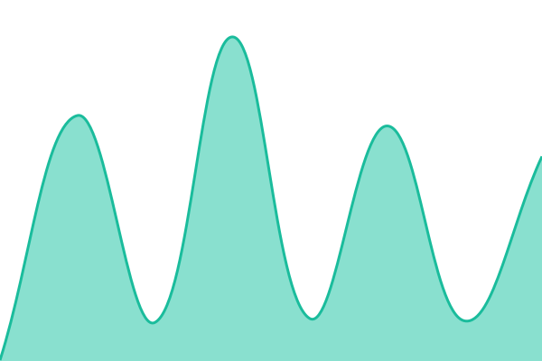

# [📈 Live Status](https://Matllorent.github.io/ScanGo-status): <!--live status--> **🟩 All systems operational**

This repository contains the open-source uptime monitor and status page for [Matllorent](https://Matllorent.github.io/ScanGo-status), powered by [Upptime](https://github.com/upptime/upptime).

With [Upptime](https://upptime.js.org), you can get your own unlimited and free uptime monitor and status page, powered entirely by a GitHub repository. We use [Issues](https://github.com/Matllorent/ScanGo-status/issues) as incident reports, [Actions](https://github.com/Matllorent/ScanGo-status/actions) as uptime monitors, and [Pages](https://Matllorent.github.io/ScanGo-status) for the status page.

<!--start: status pages-->
<!-- This summary is generated by Upptime (https://github.com/upptime/upptime) -->
<!-- Do not edit this manually, your changes will be overwritten -->
<!-- prettier-ignore -->
| URL | Status | History | Response Time | Uptime |
| --- | ------ | ------- | ------------- | ------ |
|  [ScanGo API](https://scango-rouge.vercel.app/api/healthz) | 🟩 Up | [scan-go-api.yml](https://github.com/Matllorent/ScanGo-status/commits/HEAD/history/scan-go-api.yml) | 

 620ms
     
 | 

<a href="https://Matllorent.github.io/ScanGo-status/history/scan-go-api">100.00%</a>
    

|  [ScanGo Landing](https://scango-rouge.vercel.app/) | 🟩 Up | [scan-go-landing.yml](https://github.com/Matllorent/ScanGo-status/commits/HEAD/history/scan-go-landing.yml) | 

 188ms
     
 | 

<a href="https://Matllorent.github.io/ScanGo-status/history/scan-go-landing">100.00%</a>
    

|  [Menu demo](https://scango-rouge.vercel.app/m/demo-heladeria) | 🟩 Up | [menu-demo.yml](https://github.com/Matllorent/ScanGo-status/commits/HEAD/history/menu-demo.yml) | 

 183ms
     
 | 

<a href="https://Matllorent.github.io/ScanGo-status/history/menu-demo">100.00%</a>
    

<!--end: status pages-->

[**Visit our status website →**](https://Matllorent.github.io/ScanGo-status)

## 📄 License

- Powered by: [Upptime](https://github.com/upptime/upptime)
- Code: [MIT](./LICENSE) © [Anand Chowdhary](https://anandchowdhary.com)
- Data in the `./history` directory: [Open Database License](https://opendatacommons.org/licenses/odbl/1-0/)
